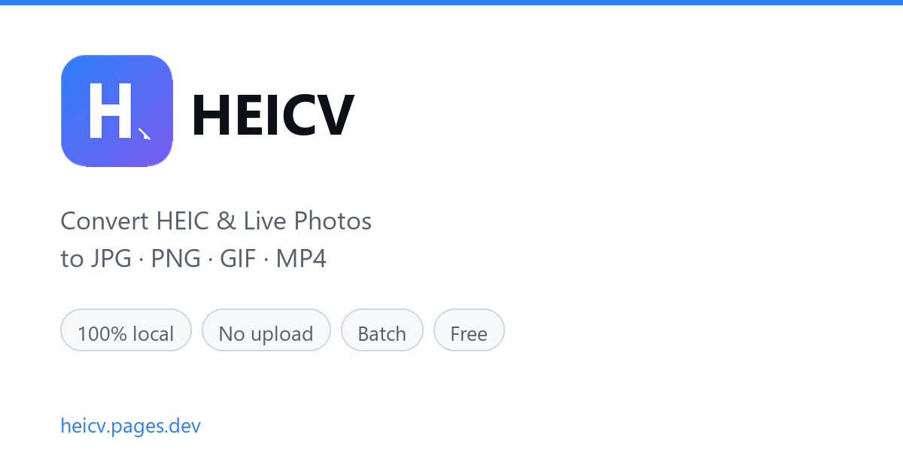

# HEICV — HEIC & Live Photo Converter

A minimal Manifest V3 browser extension for **converting HEIC photos to JPG/PNG** and **turning Live Photos into GIF or MP4** — entirely in your browser, with no uploads.

**[Open the converter →](https://heicv.pages.dev/)** · [Firefox Add-ons](https://addons.mozilla.org/firefox/) · [中文说明](README.zh-CN.md)



---

## What this is

This repository contains the **extension shell only** (Firefox MV3). It performs no image processing.

All HEIC decoding and Live Photo conversion runs on the website, in WebAssembly, locally. The extension does exactly two things:

1. Opens the converter when you click the icon
2. Injects a bridge so the page can trigger a native file/folder picker

```
manifest.json       MV3 manifest
src/popup.html      popup UI
src/popup.js        two buttons: open converter / pick files
src/bridge.js       page ↔ extension bridge (~70 lines)
_locales/           en / zh_CN
icons/              16 / 48 / 128
```

## Features

- **HEIC / HEIF → JPG or PNG** — batch convert an entire folder at once
- **Live Photo → GIF or MP4** — auto-detects HEIC+MOV pairs; MP4 is typically 30–50× smaller than GIF
- **100% local** — no server, no upload, no account, no watermark
- **Memory efficient** — the decoder and output buffer are reused; 100 photos add only ~4.5 MB

## Why the extension is this small

This split wasn't arbitrary — it follows from four constraints:

| Constraint | Consequence |
| --- | --- |
| WASM + Worker need a relaxed CSP than MV3 extension pages allow | Processing lives on the website |
| The decoder needs ongoing tuning; a store review per change is too slow | The site deploys instantly |
| Fewer permissions means faster review and more trust | No `activeTab`, no `<all_urls>`, no `downloads` |
| The converter must work without the extension | The extension is purely additive |

The trade-off: the site's `host_permissions` must cover the landing page. Currently `*.pages.dev` and `*.vercel.app`, so hosting can move.

## How bridge.js works

Web pages cannot read local folders directly — that's the browser security model. This is the extension's only real added capability:

```js
// Page sends a message → bridge creates a hidden <input type=file> → user picks → File objects are dispatched back
window.postMessage({ source: 'heicv-page', type: 'open-files' }, location.origin)
```

The page listens for `heicv-files-selected` and receives `File[]`. Reading, decoding, and conversion all happen in the page. **The bridge never reads file contents and makes no network requests.**

All messaging uses `location.origin` as `targetOrigin` and checks `e.source === window`, so a third-party iframe cannot forge messages.

It also sets `data-heicv-ext="1.0.1"` on `<html>`, which the site uses to hide the "install the extension" hint.

## Permissions

```json
"permissions": ["storage", "tabs"],
"host_permissions": ["https://*.pages.dev/*", "https://*.vercel.app/*"]
```

- `tabs` — open the converter in a new tab
- `storage` — remember language preference
- `host_permissions` — inject `bridge.js` on the landing page only

No `activeTab`, no `<all_urls>`, no `downloads`, no remote code.

## Load locally

**Firefox**

1. Open `about:debugging#/runtime/this-firefox`
2. *Load Temporary Add-on*
3. Select `manifest.json` in this directory

**Chrome / Edge** (remove `browser_specific_settings` or ignore the warning)

1. Open `chrome://extensions`
2. Enable Developer mode
3. *Load unpacked* → select this directory

Requires Firefox **140+** (uses the `data_collection_permissions` field).

## FAQ

**Is it really free?**
Yes — no limits, no sign-up, no watermark.

**Are my photos uploaded anywhere?**
No. Decoding and conversion happen inside your browser via WebAssembly. Files never leave your device.

**Can it convert HEIC in batch?**
Yes. Drop an entire folder; the decoder is reused and memory is freed per image.

**Does it work on Windows and Mac?**
Yes — any modern browser (Chrome, Edge, Firefox, Safari) on Windows, macOS, Linux, Android, and iOS.

## Related

- Converter: <https://heicv.pages.dev/> · 中文版 <https://heicv.pages.dev/zh/>
- Technical write-up (Chinese): [在浏览器里批量解码 HEIC](https://note.zhishangchunqiu.cn/programming/web/heic-wasm-batch-decode)
- The website source is not in this repository (production builds are obfuscated)

## License

MIT
