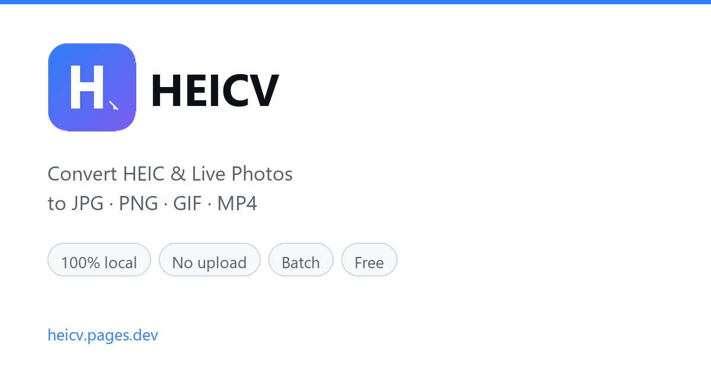

# HEICV — HEIC & Live Photo Converter

> A deliberately tiny browser extension. It opens a local-only HEIC converter and adds native folder picking — nothing else.

**在线使用：** <https://heicv.pages.dev/>
**Firefox 扩展：** <https://addons.mozilla.org/firefox/>



---

## 这个仓库是什么

这是 HEICV 浏览器的**扩展端源码**（Firefox MV3）。

它本身不做任何图片处理。全部解码和转换逻辑运行在网站上（WebAssembly，本地执行，不上传文件）。扩展只负责两件事：

1. 点图标后打开转换器页面
2. 向页面注入一个 bridge，使网页能弹出原生的文件/文件夹选择器

```
manifest.json       MV3 清单
src/popup.html      弹窗界面
src/popup.js        两个按钮：打开转换器 / 选择文件
src/bridge.js       网页 ↔ 扩展的通信桥（约 70 行）
_locales/           en / zh_CN 文案
icons/              16 / 48 / 128 图标
```

## 为什么拆成「扩展 + 网站」

这个架构不是随手定的，是几个约束倒逼出来的：

| 约束 | 结论 |
| --- | --- |
| 图片处理需要 `WebAssembly` + `Worker`，而 MV3 扩展页的 CSP 很紧 | 处理逻辑放网站，CSP 宽松，能自由用 wasm |
| 转换算法会持续调优，每次改都要走一遍扩展审核太慢 | 逻辑放网站，改完直接部署，秒级生效 |
| 扩展申请越少权限，审核越快、用户越放心 | 只申请 `storage` + `tabs`，不碰文件内容 |
| 用户不装扩展也应该能用 | 网站独立可用，扩展只是增强 |

代价是网站的 `host_permissions` 必须覆盖落地页域名。目前是 `*.pages.dev` 和 `*.vercel.app`，方便换托管。

## bridge.js 在做什么

网页无法直接读取本地文件夹，这是浏览器安全模型决定的。扩展唯一的增值能力就在这里：

```js
// 页面发消息 → bridge 创建一个隐藏的 <input type=file> → 用户选完 → 把 File 对象派发回页面
window.postMessage({ source: 'heicv-page', type: 'open-files' }, location.origin)
```

页面侧监听 `heicv-files-selected` 事件拿到 `File[]`，之后的读取、解码、转换全部在页面自己完成。**bridge 不读取文件内容，不发任何网络请求。**

通信全部用 `location.origin` 作为 targetOrigin，且校验 `e.source === window`，避免第三方 iframe 伪造消息。

它还会在 `<html>` 上打一个 `data-heicv-ext="1.0.1"` 标记，网站据此隐藏「建议安装扩展」的提示条。

## 权限说明

```json
"permissions": ["storage", "tabs"],
"host_permissions": ["https://*.pages.dev/*", "https://*.vercel.app/*"]
```

- `tabs` — 点击按钮时新开一个转换器标签页
- `storage` — 记住语言偏好
- `host_permissions` — 仅在落地页上注入 bridge.js

没有 `activeTab`，没有 `<all_urls>`，没有 `downloads`，没有远程代码。

## 本地加载（调试用）

**Firefox**

1. 打开 `about:debugging#/runtime/this-firefox`
2. 「临时载入附加组件」
3. 选择本目录下的 `manifest.json`

**Chrome / Edge**（需把 `browser_specific_settings` 去掉，或忽略警告）

1. 打开 `chrome://extensions`
2. 开启「开发者模式」
3. 「加载已解压的扩展程序」→ 选择本目录

## 技术要求

- Firefox **140+**（用到 `data_collection_permissions` 字段）
- Manifest V3

## 相关

- 在线转换器：<https://heicv.pages.dev/>
- 转换器在本地完成解码（libheif WASM）、批量内存优化（100 张 ≈ 4.5 MB）、Live Photo → GIF/MP4
- 网站源码不在此仓库（含混淆产物，不公开）

## 许可

MIT

---

作者：**[董铭月](https://zhishangchunqiu.cn)** · [董铭月の小站](https://zhishangchunqiu.cn)
